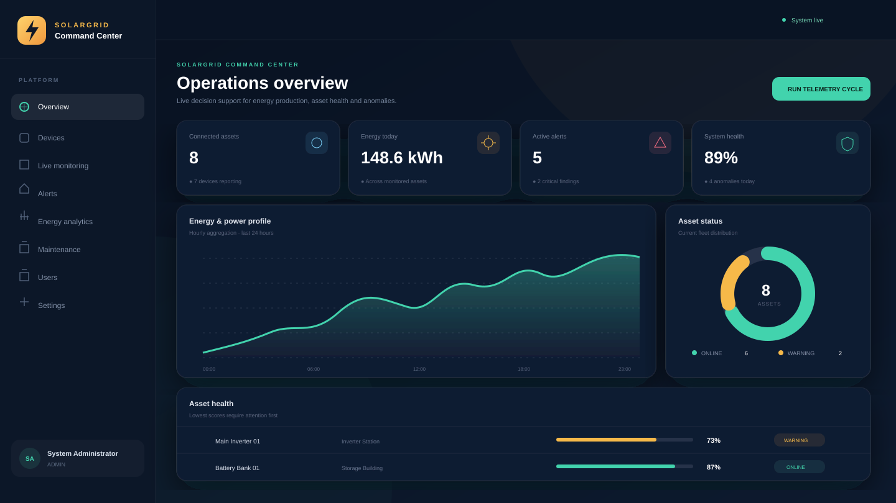
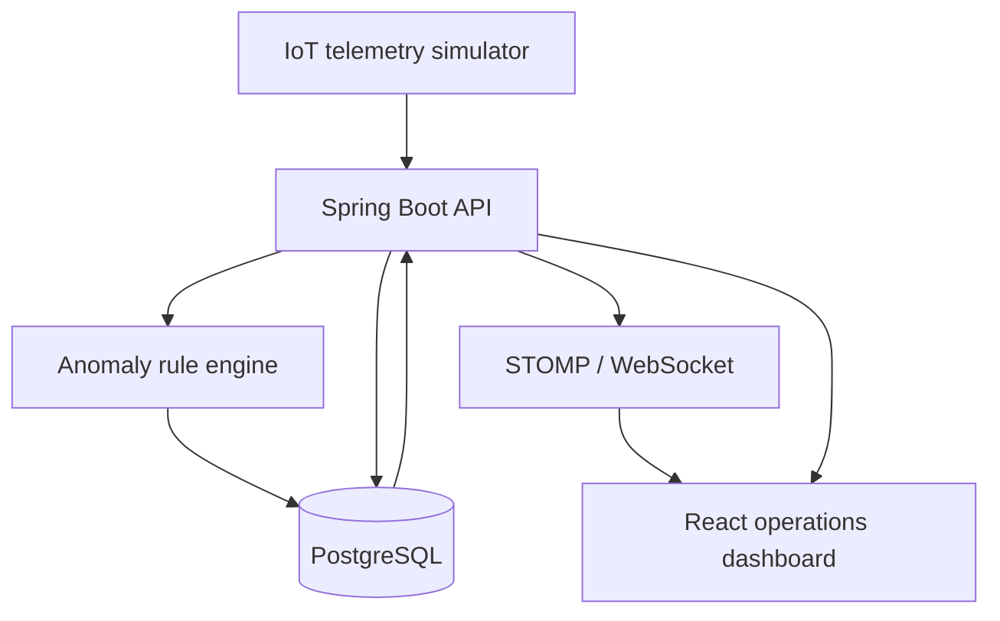

# SolarGrid IoT Monitoring Dashboard

> A full-stack smart solar-grid platform that monitors IoT assets, streams live telemetry, detects transparent rule-based anomalies, generates alerts, and turns energy data into operational decisions.



[](https://openjdk.org/)
[](https://spring.io/projects/spring-boot)
[](https://react.dev/)
[](https://www.postgresql.org/)
[](https://docs.docker.com/compose/)


## Why this project?

SolarGrid demonstrates more than CRUD. It follows a decision-support workflow:

1. collect measurements from simulated solar-grid IoT devices;
2. evaluate each signal with explainable safety and consistency rules;
3. create deduplicated alerts and security events;
4. compute a device health score;
5. present the result through a role-aware operations dashboard.

It connects full-stack engineering with smart grids, IoT monitoring, solar-energy analytics and cyber-physical security.

## Features

- JWT authentication and public Viewer registration
- role-based access for `ADMIN`, `ENGINEER`, `OPERATOR` and `VIEWER`
- device inventory with create, read, update and delete operations
- PostgreSQL persistence and automatic demo-data initialization
- scheduled telemetry simulation for panels, inverter, battery, smart meter, weather station and grid node
- STOMP over WebSocket live sensor stream
- production, voltage, temperature, frequency and battery visualizations
- explainable rule-based anomaly detection
- alert workflow: Open → In Progress → Resolved/Ignored
- deduplication of active alerts by device and rule
- computed device and fleet health scores
- maintenance logbook with an auditable engineer identity
- user and role management for administrators
- CSV energy export, Swagger/OpenAPI and Postman collection
- responsive dark operations interface
- Docker Compose and GitHub Actions CI

## Architecture



The React client uses REST for commands and historical queries. The backend publishes each new reading to `/topic/readings`, while the same reading is persisted, evaluated and reflected in health scores.

## Detection rules

| Rule | Condition | Severity |
|---|---|---|
| High temperature | temperature > 75 °C | High |
| Low battery | battery level < 20% | High |
| Voltage anomaly | voltage < 180 V or > 260 V | Critical |
| Device offline | telemetry device reports offline | Critical |
| Production drop | power falls by more than 40% | Medium |
| Frequency anomaly | frequency outside 49.5–50.5 Hz | Critical |
| False-data injection signal | power conflicts with voltage/current relationship | Critical |
| Suspicious meter reading | interval energy exceeds expected meter range | High |

These rules are deliberately interpretable. They provide a clean extension point for a future federated-learning or ML anomaly score.

## Technology stack

| Layer | Technology |
|---|---|
| Backend | Java 21, Spring Boot, Spring Security, Spring Data JPA |
| Authentication | JWT with BCrypt password hashing |
| Live channel | Spring WebSocket, STOMP |
| API documentation | Springdoc OpenAPI / Swagger UI |
| Frontend | React 19, Vite, React Router, Axios |
| Visualization | Recharts, Lucide icons, Tailwind CSS |
| Database | PostgreSQL 17 |
| Delivery | Docker, Docker Compose, Nginx, GitHub Actions |
| Tests | JUnit 5, AssertJ, ESLint, Vite production build |

## Quick start with Docker

### Requirements

- [Docker Desktop](https://www.docker.com/products/docker-desktop/) running
- 4 GB free memory recommended

### Windows — one click

Double-click:

```text
start_windows.bat
```

The script builds the containers, opens the application and keeps the database in a Docker volume.

### Terminal

```bash
docker compose up --build -d
```

Open:

- application: <http://localhost:3000>
- Swagger UI: <http://localhost:8080/swagger-ui.html>
- API health: <http://localhost:8080/actuator/health>

Stop without deleting data:

```bash
docker compose down
```

Reset the demo database:

```bash
docker compose down -v
docker compose up --build -d
```

## Demo accounts

| Role | Email | Password |
|---|---|---|
| Admin | `admin@solargrid.local` | `Admin123!` |
| Engineer | `engineer@solargrid.local` | `Engineer123!` |
| Operator | `operator@solargrid.local` | `Operator123!` |
| Viewer | `viewer@solargrid.local` | `Viewer123!` |

Change the administrator credentials and JWT secret in `.env` before any non-demo deployment. Copy `.env.example` to `.env` to begin.

## Role permissions

| Capability | Admin | Engineer | Operator | Viewer |
|---|:---:|:---:|:---:|:---:|
| View dashboard, devices and analytics | ✓ | ✓ | ✓ | ✓ |
| Generate a telemetry cycle | ✓ | ✓ | ✓ | — |
| Update alert status | ✓ | ✓ | ✓ | — |
| Create/update devices | ✓ | ✓ | — | — |
| Create maintenance records | ✓ | ✓ | — | — |
| Delete devices | ✓ | — | — | — |
| Manage users and roles | ✓ | — | — | — |

## Key API endpoints

| Method | Endpoint | Purpose |
|---|---|---|
| POST | `/api/auth/login` | issue JWT |
| POST | `/api/auth/register` | create Viewer account |
| GET | `/api/dashboard/summary` | operations KPIs |
| GET | `/api/dashboard/energy-production` | hourly energy/power series |
| GET | `/api/dashboard/anomaly-statistics` | anomaly distribution |
| GET/POST | `/api/devices` | list/create devices |
| GET/PUT/DELETE | `/api/devices/{id}` | device detail/update/delete |
| GET | `/api/devices/{id}/readings` | device telemetry history |
| GET | `/api/sensor-readings/latest` | recent global readings |
| POST | `/api/sensor-readings/simulate` | trigger one telemetry cycle |
| GET | `/api/alerts/active` | unresolved alerts |
| PATCH | `/api/alerts/{id}/status` | move alert workflow |
| GET/POST | `/api/maintenance-logs` | maintenance logbook |
| GET | `/api/security-events` | cyber-physical findings |
| WS | `/ws` → `/topic/readings` | live telemetry stream |

Import [`postman/SolarGrid.postman_collection.json`](postman/SolarGrid.postman_collection.json) for ready-made API requests.

## Local development without Docker

### Backend

Requirements: Java 21, Maven 3.9+, PostgreSQL.

```bash
cd backend
mvn spring-boot:run
```

The datasource defaults are defined in `backend/src/main/resources/application.yml`. Prefer environment variables for local secrets.

### Frontend

Requirements: Node.js 22+.

```bash
cd frontend
npm ci
npm run dev
```

Vite opens <http://localhost:5173> and proxies `/api` and `/ws` to the backend on port 8080.

## Tests and quality checks

```bash
cd backend
mvn clean verify
```

```bash
cd frontend
npm ci
npm run lint
npm run build
```

## Project structure

```text
solargrid-iot-monitoring-dashboard/
├── backend/                 Spring Boot API, rules, persistence and tests
├── frontend/                React dashboard and Nginx production image
├── docs/                    GitHub preview and supporting documentation
├── postman/                 Ready-to-import API collection
├── .github/workflows/       Backend and frontend CI
├── docker-compose.yml       PostgreSQL + backend + frontend
├── start_windows.bat        One-click Windows launcher
└── README.md
```

## Future improvements

- federated-learning security tab for multiple solar sites
- FDIA and denial-of-service attack simulation scenarios
- learned anomaly scoring beside the explainable baseline
- MQTT ingestion from physical gateways
- multi-site tenancy and geographic visualization
- predictive maintenance model
- PDF incident and sustainability reports
- weather-service integration and production forecasting

## Disclaimer

All telemetry is synthetic and intended for education, portfolio demonstration and research prototyping. The rule thresholds are not a substitute for a certified protection system or site-specific engineering limits.


